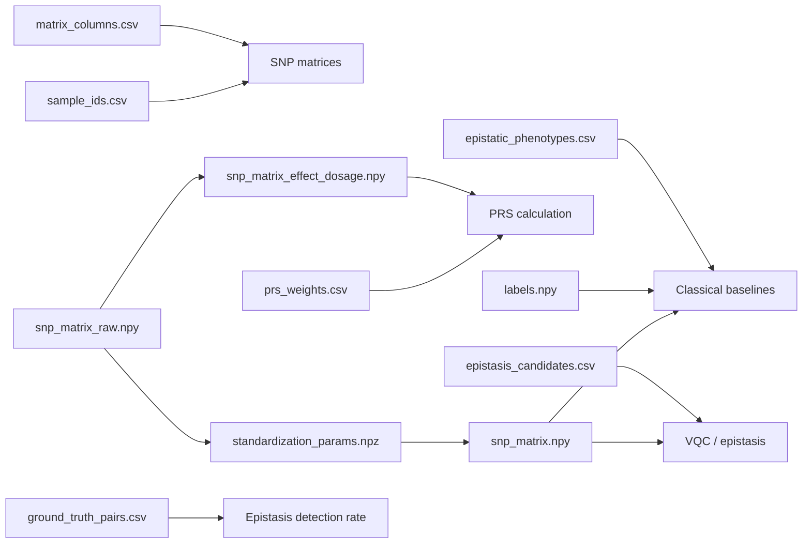

# QGenomix Mem1 Data Handoff v2 Guide

**Build date:** 24 June 2026  
**Dataset:** 1000 Genomes Phase 3 autosomes, quality-controlled and reduced to 1000 T2D-associated SNPs  
**Samples:** 2504  
**Features:** 1000 SNPs  
**Labels:** Synthetic T2D-like case/control labels for research and model testing

## 1. Purpose

This directory is the corrected and authoritative Mem1 data handoff for the downstream classical ML, PRS, VQC, epistasis, evaluation, and explainability pipelines.

The v2 package fixes the feature-order ambiguity in v1. PLINK exported SNPs in genomic order, while the earlier metadata was ranked by GWAS p-value. In v2, every matrix column, SNP ID, GWAS beta, dosage allele, candidate pair, and ground-truth pair is explicitly aligned.

> **Use v2 for all final work. Do not use positional metadata or pair files from v1.**

## 2. Plain-Language Overview

Think of the dataset as a spreadsheet:

- Each **row** is one person/sample.
- Each **column** is one SNP.
- `sample_ids.csv` names the rows.
- `matrix_columns.csv` names and describes the columns.
- `labels.npy` says whether each row is a simulated case or control.
- The three SNP matrices contain the same people and SNPs, but represent the SNP values differently for different tasks.

## 3. Non-Negotiable Alignment Rules

### Row alignment

For every row index `i`:

```text
snp_matrix.npy[i]
snp_matrix_raw.npy[i]
snp_matrix_effect_dosage.npy[i]
labels.npy[i]
sample_ids.csv row i
epistatic_phenotypes.csv row i
```

all refer to the same sample.

### Column alignment

For every column index `j`:

```text
snp_matrix.npy[:, j]
snp_matrix_raw.npy[:, j]
snp_matrix_effect_dosage.npy[:, j]
matrix_columns.csv row j
prs_weights.csv row j
standardization_params.npz arrays[j]
matrix_snp_ids.txt line j + 1
```

all refer to the same SNP.

Never independently sort `matrix_columns.csv`, `prs_weights.csv`, or either matrix.

### Pair-index alignment

The fields `snp_idx_a` and `snp_idx_b` are zero-based column indices into `snp_matrix.npy`.

For example:

```python
pair_values = X[:, [snp_idx_a, snp_idx_b]]
```

## 4. File Dependency Map



## 5. File-by-File Reference

### `snp_matrix.npy`

**Technical description:** A NumPy `float32` array with shape `(2504, 1000)`. Each SNP column was mean-centered and divided by its standard deviation after missing-value imputation.

**Simple description:** The main ML-ready table. It contains 2504 people and 1000 standardized SNP measurements.

**Use for:**

- Logistic regression
- Random forest
- XGBoost
- SVM
- VQC input preparation
- Epistasis interaction modeling
- PCA and most model-oriented EDA

**Depends on:**

- `sample_ids.csv` for row names
- `matrix_columns.csv` for column names
- `standardization_params.npz` for reproducibility
- `labels.npy` or `epistatic_phenotypes.csv` for supervised learning

**Do not use for:** Canonical PRS. PRS requires unstandardized effect-allele dosage.

---

### `snp_matrix_raw.npy`

**Technical description:** A NumPy `float32` array with shape `(2504, 1000)`. Values are imputed PLINK counted-allele dosages in `{0, 1, 2}`. The counted allele is recorded in `matrix_columns.csv`.

**Simple description:** The unstandardized genotype counts exactly as exported and ordered by PLINK.

**Use for:**

- Reproducing `snp_matrix.npy`
- Genotype QC and distribution checks
- Checking allele-count transformations
- Recomputing alternative normalization methods

**Depends on:**

- `matrix_columns.csv`, especially `plink_counted_allele`
- `sample_ids.csv`
- `standardization_params.npz`

**Do not directly combine with GWAS beta** unless dosage alleles are aligned. Use `snp_matrix_effect_dosage.npy` for PRS.

---

### `snp_matrix_effect_dosage.npy`

**Technical description:** A NumPy `float32` array with shape `(2504, 1000)`. Each column is the dosage of the GWAS effect allele, with values in `{0, 1, 2}`.

For columns where PLINK counted the non-effect allele:

```text
effect dosage = 2 - PLINK counted dosage
```

**Simple description:** The PRS-ready genotype table. Each number counts how many copies of the GWAS risk/effect allele a person has.

**Use for:**

- Canonical polygenic risk score calculation
- PRS validation and comparison

**Depends on:**

- `prs_weights.csv`
- `matrix_columns.csv`
- `sample_ids.csv`

**Primary formula:**

```python
effect_dosage = np.load("snp_matrix_effect_dosage.npy")
beta = pd.read_csv("prs_weights.csv")["beta"].to_numpy()
prs = effect_dosage @ beta
```

---

### `standardization_params.npz`

**Technical description:** A NumPy archive containing:

- `imputation_median`: value used to fill missing dosage per SNP
- `mean`: per-SNP mean after imputation
- `std`: per-SNP standard deviation after imputation
- `zero_std_mask`: marks constant columns
- `snp_ids`: SNP IDs in authoritative matrix-column order

**Simple description:** The recipe used to turn the raw matrix into the standardized matrix.

**Use for:**

- Reproducing preprocessing
- Transforming future samples using training-data parameters
- Auditing or reversing standardization

**Reconstruction:**

```python
raw = np.load("snp_matrix_raw.npy")
params = np.load("standardization_params.npz")
X = (raw - params["mean"]) / params["std"]
```

---

### `matrix_columns.csv`

**Technical description:** The authoritative mapping from zero-based matrix column index to SNP and GWAS metadata.

Important columns include:

- `column_index`
- `snp_id`
- `chrom`, `pos`
- `ref`, `alt`
- `plink_counted_allele`
- `gwas_effect_allele`
- `gwas_non_effect_allele`
- `gwas_beta`, `gwas_se`, `gwas_eaf`
- `gwas_pval_association`, `gwas_score`
- `allele_alignment`
- `effect_dosage_transform`

**Simple description:** The column dictionary. It tells exactly which SNP every matrix column represents and how its alleles were aligned.

**Use for:**

- Feature-name lookup
- SHAP/feature-importance labels
- PRS verification
- Candidate-pair interpretation
- Reproducible SNP reporting

**Rule:** This file defines matrix order. Never substitute the v1 ranked metadata file.

---

### `matrix_snp_ids.txt`

**Technical description:** One SNP ID per line in matrix-column order. Line 1 corresponds to column index 0.

**Simple description:** A lightweight ordered list of all 1000 matrix column names.

**Use for:**

- Quick feature-order checks
- PLINK extraction
- Debugging column alignment

**Depends on:** `matrix_columns.csv` as the richer authoritative source.

---

### `prs_weights.csv`

**Technical description:** Allele-aligned linear GWAS weights in exactly the same order as `snp_matrix_effect_dosage.npy`.

Columns:

- `column_index`
- `snp_id`
- `effect_allele`
- `non_effect_allele`
- `beta`

**Simple description:** One GWAS effect size for each of the 1000 SNP columns.

**Use for:** Computing PRS with `snp_matrix_effect_dosage.npy`.

**Do not confuse with:** `beta_interaction` in `ground_truth_pairs.csv`. PRS beta is a single-SNP linear weight; ground-truth beta is a synthetic SNP-pair interaction coefficient.

---

### `sample_ids.csv`

**Technical description:** Contains 2504 sample IDs in matrix-row order.

**Simple description:** The row-name list for every matrix.

**Use for:**

- Joining predictions back to samples
- Aligning labels
- Verifying train/validation/test splits
- Preventing row-order mistakes

**Rule:** Join or validate by `sample_id`; never assume an unrelated phenotype file has the same order.

---

### `labels.npy`

**Technical description:** A NumPy integer array with shape `(2504,)`. Values are `0` for control and `1` for case.

**Simple description:** The model answer vector.

**Use for:**

- Supervised classical ML
- VQC training
- Stratified data splitting
- Classification metrics

**Relationship:** It contains the same case/control values as the `case_control` column in `epistatic_phenotypes.csv`.

---

### `epistatic_phenotypes.csv`

**Technical description:** One row per sample with:

- `sample_id`
- `case_control`
- `liability_score`

The case threshold was selected to produce approximately 10% cases.

**Simple description:** The readable label file. It says which samples are simulated cases or controls and includes the underlying continuous score.

**Use for:**

- Loading labels by sample ID
- Class-balance reporting
- Liability-score analysis
- Auditable train/test preparation

**Important:** These are synthetic research labels, not real clinical T2D diagnoses.

---

### `epistasis_candidates.csv`

**Technical description:** Contains 500 candidate SNP pairs. Candidate SNPs were ranked using GWAS strength, high-LD pairs with `r² > 0.2` were excluded, and the remaining pairs were ranked by interaction score.

Important columns:

- `pair_rank`
- `snp_idx_a`, `snp_idx_b`
- `snp_id_a`, `snp_id_b`
- `interaction_score`
- `r2`

**Simple description:** The shortlist of SNP pairs that the quantum/epistasis model should examine.

**Use for:**

- VQC pair encoding
- Pair-based dataset mode
- Candidate interaction benchmarking
- Comparing detected pairs with known simulated truth

**Depends on:**

- `snp_matrix.npy`
- `matrix_columns.csv`

---

### `ground_truth_pairs.csv`

**Technical description:** Contains the 20 synthetic SNP-pair interactions used to generate liability and case/control labels.

Columns:

- `truth_rank`
- `snp_idx_a`, `snp_idx_b`
- `snp_id_a`, `snp_id_b`
- `beta_interaction`

**Simple description:** The hidden answer key for which SNP pairs truly influenced the simulated labels.

**Use for:**

- Epistasis Detection Rate (EDR)
- Checking whether VQC/classical interaction methods recover injected pairs
- Explainability validation

**Do not use for:** PRS. These are interaction coefficients, not linear GWAS effect sizes.

---

### `validation_report.json`

**Technical description:** Machine-readable build acceptance report.

It records:

- Matrix dimensions and dtype
- Sample and feature counts
- GWAS allele-alignment count
- Raw dosage minimum and maximum
- Missing-value count
- Difference between rebuilt v2 and v1 standardized matrices
- Candidate and ground-truth pair counts
- Case/control counts
- Simulation seed and threshold

**Simple description:** The final checklist proving the package was built correctly.

**Use for:** CI checks, documentation, handoff acceptance, and reproducibility.

Expected core values:

```text
matrix shape: 2504 x 1000
GWAS-aligned SNPs: 1000
raw dosage range: 0 to 2
candidate pairs: 500
ground-truth pairs: 20
cases: 251
controls: 2253
```

---

### `SHA256SUMS.txt`

**Technical description:** SHA256 checksum for every packaged file.

**Simple description:** A fingerprint list used to detect corrupted or changed files.

**Use for:**

```powershell
Get-FileHash .\snp_matrix.npy -Algorithm SHA256
```

Compare the result with the matching line in `SHA256SUMS.txt`.

## 6. Downstream Workflows

### Classical ML baselines

Required:

```text
snp_matrix.npy
labels.npy
sample_ids.csv
matrix_columns.csv
```

Example:

```python
X = np.load("snp_matrix.npy")
y = np.load("labels.npy")
assert X.shape == (2504, 1000)
assert y.shape == (2504,)
```

Use stratified train/validation/test splits. Avoid fitting another scaler globally because `X` is already standardized.

### PRS

Required:

```text
snp_matrix_effect_dosage.npy
prs_weights.csv
sample_ids.csv
matrix_columns.csv
```

Example:

```python
D = np.load("snp_matrix_effect_dosage.npy")
weights = pd.read_csv("prs_weights.csv")
assert weights["column_index"].tolist() == list(range(D.shape[1]))
prs = D @ weights["beta"].to_numpy()
```

### VQC and epistasis

Required:

```text
snp_matrix.npy
labels.npy
epistasis_candidates.csv
ground_truth_pairs.csv
matrix_columns.csv
```

Use `snp_idx_a` and `snp_idx_b` to retrieve pair values. Use `ground_truth_pairs.csv` only for evaluation, not as a training shortcut.

### Explainability

Required:

```text
snp_matrix.npy
labels.npy
matrix_columns.csv
```

Map SHAP or feature-importance column `j` to `matrix_columns.csv[column_index == j]`.

## 7. Ownership and Handoff

### Mem1

Owns data provenance, row/column mapping, GWAS allele alignment, preprocessing parameters, labels, candidate pairs, and handoff validation.

### Classical ML/PRS owner

Uses standardized X for baselines and effect-allele dosage plus GWAS beta for PRS.

### Quantum/VQC owner

Uses standardized X, labels, and corrected candidate-pair indices.

### Evaluation owner

Uses labels for metrics and ground-truth pairs for EDR.

## 8. Version and Sharing Rules

1. Share the complete v2 ZIP rather than individual files.
2. Keep `README.txt`, this guide, `validation_report.json`, and `SHA256SUMS.txt` in the package.
3. Treat `matrix_columns.csv` as the authoritative feature order.
4. Do not mix v1 pair files or metadata with v2 matrices.
5. Do not independently sort rows or columns.
6. Record any derived train/test indices so all models use the same split.
7. Never describe the synthetic labels as real patient diagnoses.

